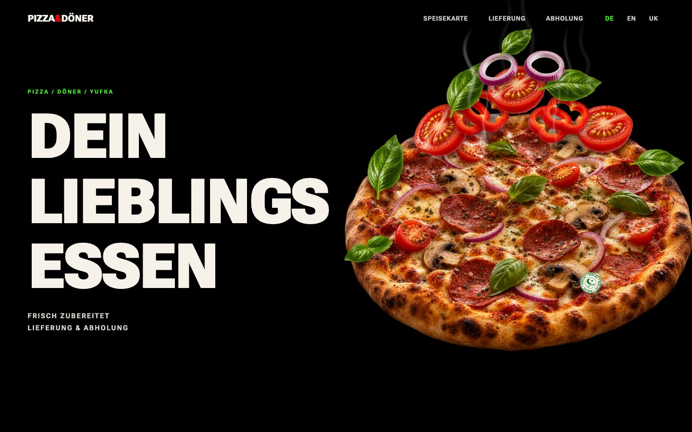

# Pizza & Döner Lieferservice (website template)



A cinematic website template for a pizza and döner delivery service. The idea: a scroll storyboard where toppings lift and fall, the camera pivots, a yufka rolls in and the pizza box opens, all on one scrubbed timeline.

**Live demo:** https://pizza-doner-lieferservice.vercel.app

## What is in this repository

The repository is organised like a small project folder, so the thinking is visible next to the code:

| Folder | Content |
|---|---|
| `00_START`, `01_BRIEF` | project start and brief |
| `02_DESIGN`, `03_ANIMATION` | design decisions, scroll storyboard and implementation notes |
| `04_CONTENT`, `05_CLIENT_INPUT` | content plan and empty client templates (no invented client data) |
| `06_ASSETS`, `09_SCREENSHOTS` | image assets and reference screenshots |
| `07_SITE_STARTER` | the Next.js site |
| `08_V2_PLAN` | next iteration plan |

## Highlights

- **Storyboard first**: a written shot list with scroll percentages for every beat before any code.
- **2.5D sprite choreography**: separate topping sprites on their own paths, with rotation, easing and landing spots.
- **Honest motion**: where true 3D was not available, the sequence uses a cinematic cut instead of faking physics (see `03_ANIMATION/IMPLEMENTATION_NOTES.md`).
- **Mobile and reduced-motion variants**: fewer sprites, shorter sequences and a static fallback.
- **Three languages**: German, English and Ukrainian.

## Stack

Next.js 15, React 19, TypeScript, GSAP, Three.js, Matter.js, Lucide icons.

## Run the site

```bash
cd 07_SITE_STARTER
npm install
npm run dev      # http://localhost:3000
npm run build
```

## Note

This is a template and starter, not a finished client site. Business name, phone, address, hours, menu and prices are intentionally empty until a client confirms them (`05_CLIENT_INPUT/UNKNOWN_FACTS.md`).
